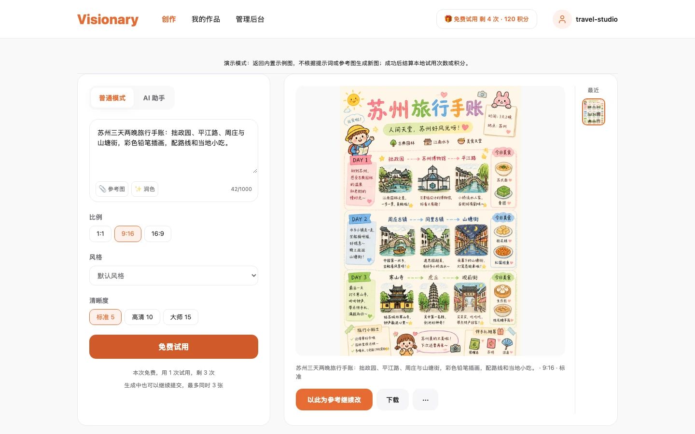
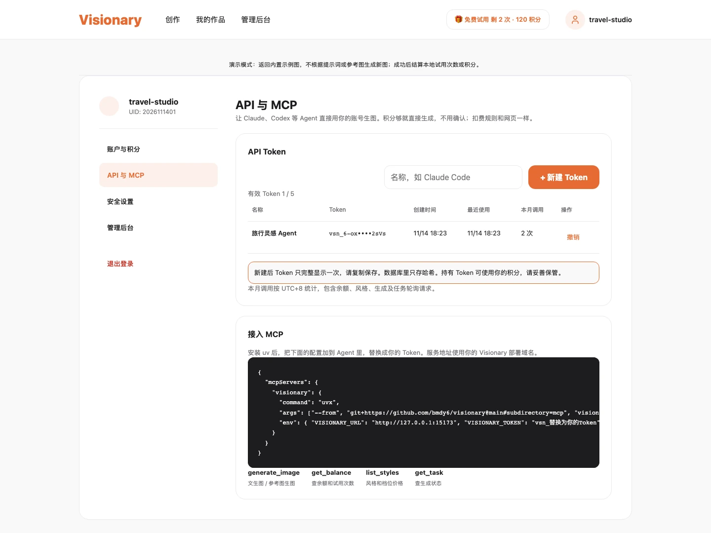
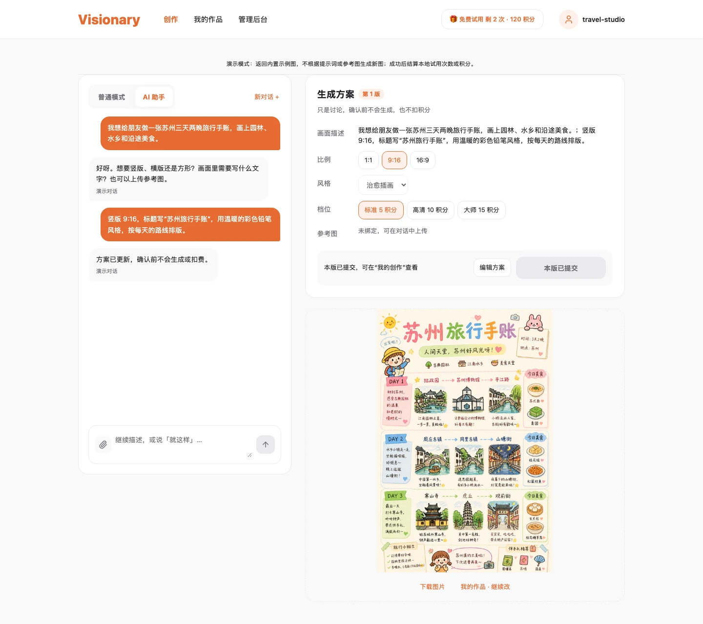
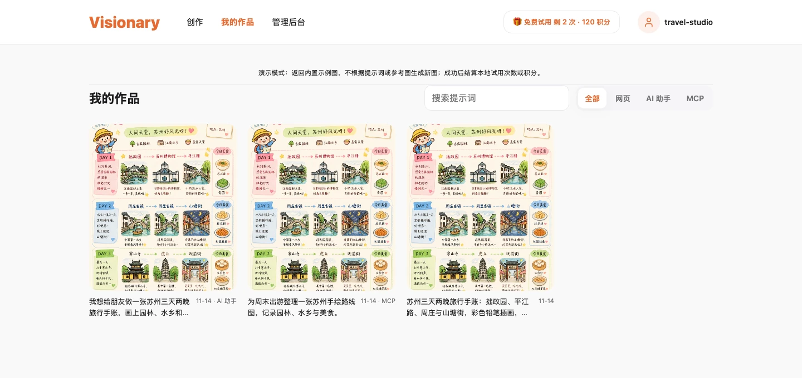
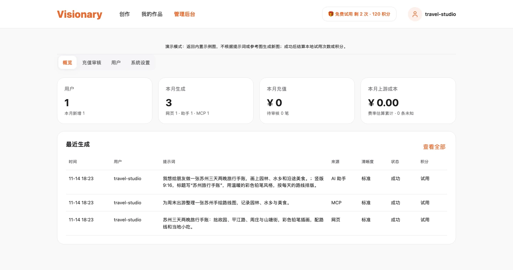

低维护：作为作品展示，Issue 可能不及时回复

# Visionary

AI image generation with credit accounting, image history, and an admin dashboard.
用 React 与 FastAPI 搭建的 AI 生图工作台，从输入灵感、查看作品到积分结算和后台管理。

<!-- readme-illustrate:creation -->


创作页：输入、档位与演示结果（[截图来源](docs/images/SOURCES.md)）。
<!-- /readme-illustrate:creation -->
## 快速开始

```bash
git clone https://github.com/bmdy6/visionary.git
cd visionary
bash scripts/dev.sh
```

准备 Python 3.10+、Node.js 22（22.13+）或 24+ 和 npm。数据库默认使用 SQLite。**不需要任何 key 就能完整体验一次生图**：登录、提交任务、等待结果、查看历史、下载与积分扣减。

脚本自动创建 `.venv`、安装前后端依赖、从 `.env.example` 生成带随机 `SECRET_KEY` 的 `.env`，初始化数据库和 `local-admin` 管理员。首次运行按提示设置至少 12 位的密码；管理员按 `NEW_USER_POINTS` 获得初始积分（默认 10），不发放试用，也不会自动开启无限积分。再次运行会保留已有配置、密码、数据和余额。

访问 <http://127.0.0.1:5173>，使用 `local-admin` 和刚设置的密码登录，填写画面描述并点击「生成 · N 积分」或「免费试用」。生成中可继续输入和提交，最多同时 3 张；成功后点「以此为参考继续改」直接装入参考图并聚焦输入框。也可用输入框底部的「参考图」上传图片、点「润色」优化基础风格的描述。作品统一进入「我的作品」，详情提供下载和分享海报。API 文档位于 <http://127.0.0.1:8000/docs>。

默认是**演示模式**：循环返回 `showcase/` 自带 PNG 示例图，不根据提示词、比例或参考图绘制新内容；页面会显示演示提示。任务仍执行冻结积分、后台处理、轮询和成功结算；新注册用户优先使用试用，默认标准档每次 5 分。图片和参考图写入 `backend/data/creations/`，经 `/api/creations/` 访问，不会提交到 Git。AI 助手无模型 key 时先追问一轮，再给演示方案；提示词润色、真实邮件和支付需各自配置。

按 `Ctrl+C` 同时停止前后端。脚本只监听回环地址；8000 或 5173 被占用时会退出，请先停止占用服务。不要删除 `.env` 或数据库来重置余额；需要补积分时使用本地管理后台。默认脚本用于本地开发。

## 在 Agent 里使用

先启动 Visionary，在「个人中心 → API 与 MCP」填写名称并创建 Token。`vsn_` 明文只在创建时显示一次；列表仅显示前缀、后四位、创建时间、最近使用与本月调用数。关闭明文后无法找回，需要撤销并新建。Token 等同允许消费你账号的积分，请只交给信任的 Agent。

<!-- readme-illustrate:api-mcp -->


API 与 MCP：管理个人 Token，并复制 Agent 接入配置；图中仅显示临时 Token 的遮罩与配置占位符。
<!-- /readme-illustrate:api-mcp -->
安装 [uv](https://docs.astral.sh/uv/getting-started/installation/)，在 MCP 客户端加入配置：

```json
{
  "mcpServers": {
    "visionary": {
      "command": "uvx",
      "args": ["--from", "git+https://github.com/bmdy6/visionary@main#subdirectory=mcp", "visionary-mcp"],
      "env": {
        "VISIONARY_URL": "https://your-visionary.example",
        "VISIONARY_TOKEN": "vsn_REPLACE_WITH_YOUR_TOKEN"
      }
    }
  }
}
```

命令行启动相同服务：

```bash
# 先在本机安全设置 VISIONARY_URL 与 VISIONARY_TOKEN，勿将真实 Token 提交到仓库。
uvx --from 'git+https://github.com/bmdy6/visionary@main#subdirectory=mcp' visionary-mcp
```

本地演示使用 `VISIONARY_URL=http://127.0.0.1:8000`；正式域名必须 HTTPS。若需要未显式指定分支的等价写法，可用 `git+https://github.com/bmdy6/visionary#subdirectory=mcp`。包尚未发布 PyPI/npm；这里用 uvx 从 main 安装 Python 包，不能直接写 `npx visionary-mcp`。本地包验证（在仓库根目录执行）：`uvx --from ./mcp visionary-mcp`。

| 工具 | 行为 |
| --- | --- |
| `generate_image(prompt, aspect_ratio, style, tier, reference_image?, save_path?, wait_seconds?)` | 每次一张；试用或积分够就直接提交，无确认步骤。不足返回 `balance`、`trial_remaining`、`required`、`recharge_url`，不建任务。参考图支持 URL、data URL 或本地 PNG/JPEG/WebP 路径；本地文件最多 20 MiB。 |
| `get_task(task_id)` | 仅查自己的任务；成功返回绝对图片 URL。 |
| `get_balance()` | 可用积分、可用试用、无限开关与充值链接。 |
| `list_styles()` | 风格 ID、实时档位价格、试用档位和 MCP 单次上限。 |

`generate_image` 默认等待 180 秒，最多 300 秒；`wait_seconds=0` 可立即返回 `task_id`。等待超时或轮询中断后用 `get_task` 继续查询，**不要重新提交**。提交响应本身丢失时可能已生成任务，先去「我的作品」检查；普通生成没有幂等键，不自动重试。`save_path` 可指定本地输出，已有文件会在生成前拒绝；下载失败仍返回已生成的 URL 与 `save_error`，不要为保存失败再次生成。文件下载不向存储域名转发 Token。

三个查询工具标 `readOnlyHint=true`，生成标 false、非幂等。注解向客户端描述副作用，客户端仍可有自己的工具授权策略；服务端不加逐次生成确认。每个已认证的允许接口 HTTP 请求计一次调用，包含轮询，按 UTC+8 自然月重置显示。

个人 Token 只授权 `POST /api/image/generate`、`GET /api/image/status/{id}`、`GET /api/image/balance`、`GET /api/image/styles`，不可访问充值、改密码、后台、助手方案或 Token 管理。撤销后后续请求立即失效；已经提交的生成任务继续完成。生成记录的来源由服务端标 `mcp`，进入同一「我的作品」和消费明细。数据库只保存 SHA-256 哈希与展示用前后缀，不存明文。

## 功能

- **AI 助手**：先聊方案、上传参考图、版本编辑，确认后才生成；无 key 可用演示对话。
- **免费试用与配置**：新用户默认 5 次标准档试用，优先试用再积分；后台可调整试用、档位价格、注册积分。
- **创作工作台**：文字生图、参考图生图、画面比例选择、风格模板与提示词润色，支持连续提交，最多同时 3 张；结果出现后输入区仍可用。
- **作品管理**：按网页 / AI 助手 / MCP 来源筛选，详情中继续改、删除、下载和分享海报。
- **账号与积分**：JWT 登录、邮件验证码注册和找回密码；积分余额、消费与充值明细、人工充值报备。
- **Agent 接入**：个人 API Token 与 MCP，共用网页的积分、试用和历史；管理员可按用户开启无限积分，仍记录成本。
- **管理后台**：概览、充值审核、用户、系统设置；手动加分位于用户详情，成本从任务记录自动汇总。
- **桌面与移动端**：同一套响应式工作台，移动输入固定底部；保留可安装的 PWA，无安装奖励。

### AI 助手与免费试用

<!-- readme-illustrate:assistant -->


AI 助手：先讨论方案，确认后再生成，结果保留在同一工作台。
<!-- /readme-illustrate:assistant -->
创作首页可切换「普通模式 / AI 助手」，浏览器会记住上次选择。助手先聊需求、绑定参考图并给出方案，只有点击「确认生成」才进入原有生成流程；聊天中说“生成”不会直接提交。方案可手动编辑，每次更新版本号递增，同一方案版本连点或刷新不会重复预占。结果记录来源为 `assistant`，在「我的作品」中可下载、作为新任务的参考图继续改；旧 API 的带父任务精修限制保留。

没有 `DASHSCOPE_API_KEY` / `OPENAI_API_KEY` 时使用固定演示对话。配置后复用提示词润色的 Qwen 优先、兼容接口回退选择；对话模型只读取文字和参考图绑定状态，图片本身在确认后传给生图服务。演示生成继续返回内置样图。聊天与方案存数据库，按用户隔离，可点「新对话」。每个对话最多 50 轮，模型上下文最多最近 20 条消息。

新注册用户默认有 5 次免费试用，与积分分开；标准档优先试用，其他档按配置判断。先预占，成功后扣除，失败释放。已有账号迁移后试用为 0，不补发。页面显示剩余试用、费用及不足金额；不足时可打开原充值弹窗。

### 作品与移动创作

网页、AI 助手和 MCP 生成的作品统一进入「我的作品」，可按来源筛选、查看详情、下载、继续改和分享海报。移动端使用同一套响应式工作台，输入区固定在底部。

<!-- readme-illustrate:works -->


我的作品：网页、AI 助手与 MCP 的任务统一归档，可按来源筛选。
<!-- /readme-illustrate:works -->
<!-- readme-illustrate:mobile -->


手机端：390 × 844 浏览器视口中的结果预览与底部输入区。
<!-- /readme-illustrate:mobile -->
### 页面导航与数据边界

导航保留创作、我的作品，管理员另有管理后台；个人中心合并账户、积分明细和安全设置。价格、指南、独立明细等旧页面链接统一重定向到首页。未配置完整支付参数时只显示人工充值报备，在线下单也会在写入订单前拒绝缺配置请求。分享海报二维码指向站点首页。

邀请系统、反馈、公告/维护弹窗、背景粒子和安装奖励均已移除，旧数据库字段/表保留。另有 API/MCP 账户页面和无限积分开关；API/MCP 生成使用同一 `mcp` 来源筛选。

状态查询需要登录且仅返回本人的任务，其他用户及不存在的任务均返回 404。每次上游调用尝试记录代码中 `COST_RMB` 的价格快照，演示为 0；后台自动累计本月记录，不以用户充值倒算成本。该数字是配置费率的估算，不是供应商账单。迁移前记录保持 NULL，界面标注未知，不倒填历史费用。

## 管理与配置

<!-- readme-illustrate:admin -->


管理后台：查看用户、本月生成、充值、上游成本估算和最近任务。
<!-- /readme-illustrate:admin -->
### 系统设置 · 积分与试用

管理员在「管理后台 → 系统设置」保存，当前进程立即刷新配置缓存；其他进程最多 60 秒刷新。非空 `system_configs` → 非空 `.env` / 环境变量 → 默认值。修改记录在现有充值审计流水（`CONFIG_` 前缀、零积分、管理员和前后值），不会给账号增加余额。数字限制为 0–1000000 的整数；档位必须有效。

| 配置项 | 默认值 | 用途 |
| --- | --- | --- |
| `NEW_USER_FREE_GENERATIONS` | `5` | 新账号试用次数，0 关闭新发放；不改已有余额 |
| `TRIAL_ALLOWED_TIERS` | `standard` | 逗号分隔允许使用试用的档位 |
| `NEW_USER_POINTS` | `10` | 新账号注册积分 |
| `TIER_COSTS` | `standard:5,hd:10,master:15` | 每个档位生成消耗的积分，预占后以任务快照结算 |
| `ASSISTANT_MODE_ENABLED` | `true` | 隐藏助手切换并拒绝新聊天、编辑和方案提交 |

升级已有数据库前，先停服务并备份数据库，然后运行 `python -m scripts.init_db`（复用当前 `DATABASE_URL`）。这是可重复执行的增量迁移，保留已有账号、密码和积分；`scripts/dev.sh` 也会执行它。首次建库不需要另做迁移。回退到旧版应用可保留新增表和列，勿直接删除数据库。

后端离线检查：`python -m unittest discover -s tests -v`、`python tests/offline_regression.py`。可选 headless 编辑回归在 `tests/assistant_editor.mjs`：另行安装 Playwright，设置 `VISIONARY_TEST_USERNAME`、`VISIONARY_TEST_PASSWORD` 为合成测试账号（需已有助手方案），运行 `node tests/assistant_editor.mjs`；`PLAYWRIGHT_MODULE` 可指向独立安装的模块。请使用演示或回环假服务，不调用真实付费接口。

### 无限积分与 API 配置

管理员在「管理后台 → 用户」打开指定用户的「无限积分」。默认所有用户（含管理员）关闭；不依赖用户名。开关变更与 `UNLIMITED_` 零积分审计一起提交，记录操作者与前后值。开启后显示「∞ 无限积分」，新任务不冻结积分、不扣分、不消耗试用，但生成流水仍记扣 0 分及上游费用估算；后台汇总本月生成与成本。开关变化不重新定价已提交的任务。

新建本地管理员时可选择：

```bash
python -m scripts.init_db --admin local-admin --unlimited
```

`--unlimited` 必须与 `--admin` 一起使用；`--if-missing` 保留已有账户，包括原开关，修改已有账户使用后台。升级已有数据库前先备份并停服务，再执行 `python -m scripts.init_db`；这是新增列/表的幂等迁移，不给旧用户补试用、不自动开无限积分。

新增配置也在「系统设置」内，沿用 `system_configs` 优先、环境变量回退、默认值和 60 秒缓存；当前进程保存后立即失效缓存。

| 配置 | 默认 | 说明 |
| --- | --- | --- |
| `API_TOKENS_ENABLED` | `true` | 关闭后不能创建或使用 Token，JWT 仍能列出、撤销。 |
| `API_TOKENS_PER_USER` | `5` | 有效 Token 上限；0 禁止新建，降低上限不自动撤销已有 Token。 |
| `MCP_MAX_IMAGES_PER_CALL` | `1` | 上限；工具保守地每次只生成一张，设 0 关闭 Token 生成，查询仍可用。 |

独立包及测试见 [mcp/](mcp/)。不依赖 OpenAI SDK，不直接访问付费上游；通过 Visionary HTTP 接口使用已有结算链路。

## 本地开发与部署

### 手动启动

也可以逐步执行：

```bash
python3 -m venv .venv
source .venv/bin/activate
python -m pip install -r requirements.txt
cp .env.example .env
python -c 'import secrets; print(secrets.token_urlsafe(48))'
```

将输出的随机串填入 `.env` 的 `SECRET_KEY`，保留 SQLite 的 `DATABASE_URL`。外部服务字段留空即可演示。

```bash
# 创建空表和本地管理员，按提示设置密码
python -m scripts.init_db --admin local-admin
python -m uvicorn api.index:app --host 127.0.0.1 --port 8000
```

另开终端，从仓库根目录启动前端：

```bash
cd frontend
npm ci
npm run dev -- --host 127.0.0.1 --port 5173 --strictPort
```

### 接自己的生图服务与 COS

在 `.env` 中填写并重启后端：

```dotenv
# 有 key 时 auto 自动请求自己的上游，图片仍可保存在本地
IMAGE_PROVIDER=auto
OPENAI_BASE_URL=https://your-image-provider.example/v1
OPENAI_API_KEY=填入你自己的密钥
STORAGE_BACKEND=auto
```

请求格式见 [生成接口](backend/api/image.py)：模型字符串为 `gpt-image-2`，文生图调用 `/images/generations`，参考图调用 `/images/edits` 并传入 JSON `images` 数组。需选择支持该格式及 data URL 参考图的服务；不是所有 OpenAI 兼容服务都支持。可以返回 `data[0].url` 或 `data[0].b64_json`。本地参考图会内嵌后发给上游，不要求上游访问本机。真实生图服务可能收费。

| 配置 | 默认 | 行为 |
| --- | --- | --- |
| `IMAGE_PROVIDER` | `auto` | 有 `OPENAI_API_KEY` 用 `openai`，否则 `demo`；可显式指定 |
| `STORAGE_BACKEND` | `auto` | COS 四项配全用 `cos`，否则 `local`；可显式指定 |

显式设置 `IMAGE_PROVIDER=openai` 却无 key，或 `STORAGE_BACKEND=cos` 却缺配置，会使任务失败并释放冻结积分；不会悄悄切回演示。填写了 key 和完整 COS 配置时，默认行为与原部署一致。

需要 COS 时填写 `TENCENT_CLOUD_SECRET_ID`、`TENCENT_CLOUD_SECRET_KEY`、`TENCENT_CLOUD_COS_REGION`、`TENCENT_CLOUD_COS_BUCKET`，并确保桶内图片可公开读取。邮件验证码需要 SMTP，字段见 [.env.example](.env.example)。配置表中非空值优先于环境变量，修改已有部署配置时需留意此优先级。

本地存储适合单机开发；迁移时一起备份 SQLite 数据库和 `backend/data/creations/`。图片 URL 可直接访问，没有私有文件鉴权，勿用于敏感图像；无持久磁盘或多实例部署请使用 COS，并让反向代理将 `/api` 交给后端。

### 构建与离线测试

前端生产构建（在 `frontend/` 中执行）：

```bash
npm ci
npm run build
```

后端离线回归（在仓库根目录、激活 venv 后执行，不调用付费 API）：

```bash
python -m unittest discover -s tests -v
python tests/offline_regression.py
```

## 值得看的设计

### 积分先冻结，成功扣费，失败释放

提交任务时，用条件 UPDATE 检查 `points - frozen_points`，再冻结本次额度；图片生成并存储成功后扣除余额，失败则释放冻结额度。预占与最终扣费分开，失败任务不扣减用户余额。对应的消费和充值记录可在积分明细中查看。

实现：[生成与结算](backend/api/image.py)、[积分字段](backend/models/models.py)、[明细接口](backend/api/user.py)。

### 后台生成，前端轮询状态

生成接口先创建 `pending` 记录并返回任务 ID，再由 FastAPI 后台任务完成提示词包装、上游请求与图片转存。前端按 ID 轮询 `pending / generating / success / failed` 状态，将等待过程和生成结果展示在任务卡片中；后端同时记录 API、存储与总耗时。

实现：[任务处理与状态查询](backend/api/image.py)、[响应式工作台与轮询](frontend/src/pages/HomePage.jsx)。

### 上游与存储配置独立于页面

生图上游和图片存储分别选择：没有 key 时返回内置示例图，没有完整 COS 配置时存到本地；接入自己的服务后仍走同一条后台任务与积分结算流程。配置表优先，缺项回退环境变量，并缓存 60 秒。COS 上传和本地写入集中在存储适配中，在线程池里执行；提示词润色可单独配置 Qwen 或兼容聊天接口。

实现：[配置读取](backend/core/config.py)、[提示词润色](backend/core/prompt_enhance.py)、[存储选择](backend/core/storage.py)、[演示上游](backend/core/image_provider.py)、[COS 适配](backend/core/cos.py)。更多调用关系见 [架构说明](docs/ARCHITECTURE.md)。

## 技术栈

| 部分 | 技术 |
| --- | --- |
| 前端 | React 19、Vite 8、React Router 7、Axios、Lucide、CSS |
| 图片与分享 | html2canvas、qrcode.react |
| 后端 | FastAPI、SQLAlchemy、Pydantic、HTTPX |
| 认证与存储 | python-jose、bcrypt、腾讯云 COS SDK |
| 本地数据库 | SQLite |

依赖见 [前端清单](frontend/package.json) 和 [Python 清单](requirements.txt)。代码采用 [MIT License](LICENSE)。

## 已知限制

- 后台任务在 Web 进程内运行；持久化队列、重启恢复及积分结算与重置的并发约束仍待完善。
- 对外开放前需加固接口归属、图片代理和账号验证；支付适配的回调金额校验也需完善。
- 上游有特定请求格式要求；界面档位影响计费和提示词，但发送给上游的 `quality` 均为 `low`。
- 无 key 演示仅返回已有图；本地文件需备份，删除作品仅从作品页隐藏，保留消费/成本记录和文件。真实生图、COS、邮件、支付、MySQL 和 PWA 真机仍需各自验收；依赖仍有开发工具告警。
- 历史展示素材的权利来源需单独确认，代码的 MIT 许可不覆盖第三方图像权利。

详见 [完整限制与验证范围](docs/LIMITATIONS.md)。

## 设计参考与验收历史

页面按 [Issue #5](https://github.com/bmdy6/visionary/issues/5) 的 [桌面创作](docs/design/s1-home.png)、[移动创作](docs/design/s2-mobile.png)、[我的作品](docs/design/s3-history.png)、[账户](docs/design/s4-account.png)、[后台](docs/design/s5-admin.png) 精简。设计图中的黄色便签是需求说明，不属于页面。

创作界面精简后，曾重新拍摄 1440 / 390 宽度的注册、连续生成、参考图续改、作品筛选、明细、充值审核和后台设置。这批实拍证据和逐张差异仅随对应交付报告保存，不提交到公开仓库；当时已移除展示旧界面的截图，避免与当前实现混淆。

API 与 MCP 的设计参考见 [Issue #4](https://github.com/bmdy6/visionary/issues/4)、[API 与 MCP 设计稿](docs/design/r5-api.png) 和 [无限积分设计稿](docs/design/r5-admin.png)。这些链接是设计与历史验收参考，当前运行截图见本文各功能段落。
