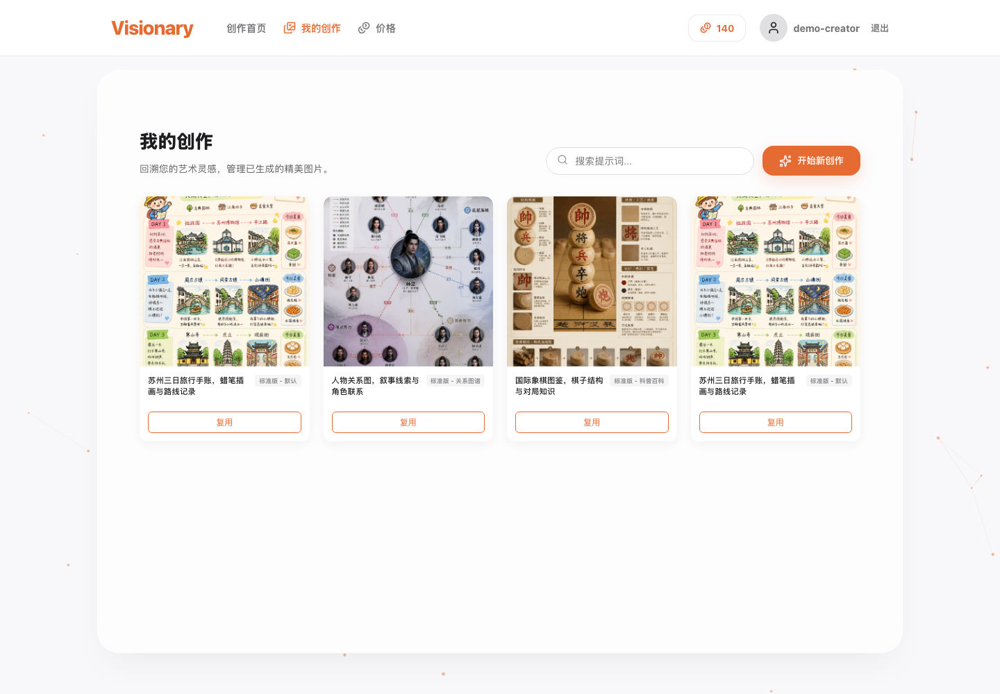
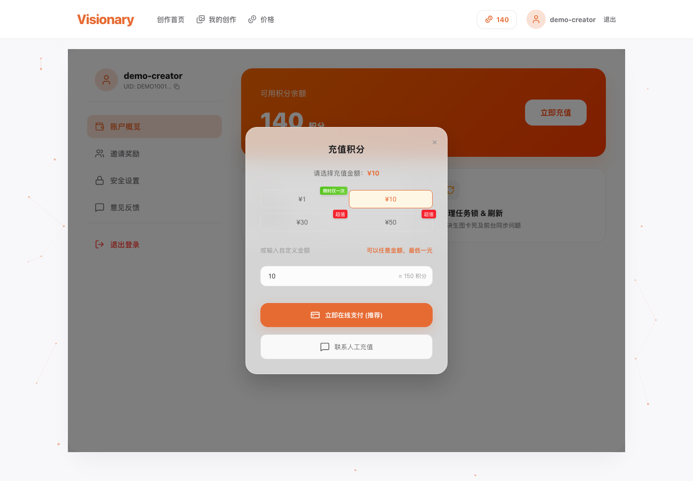
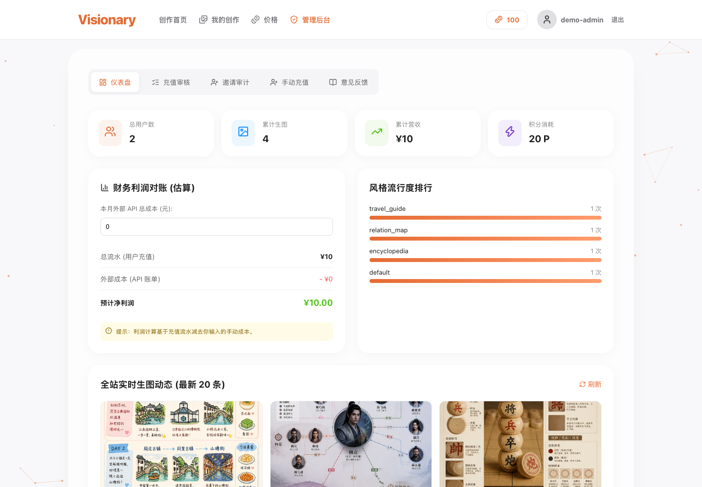

# Visionary

AI image generation with credit accounting, image history, and an admin dashboard.

用 React 与 FastAPI 搭建的 AI 生图工作台，从输入灵感、查看作品到积分结算和后台管理。

## 界面预览

<a href="docs/screenshots/home-generation.png"></a>

| 历史记录 | 积分与充值 | 管理后台 | 移动端 |
| --- | --- | --- | --- |
| [](docs/screenshots/history.png) | [](docs/screenshots/credits-recharge.png) | [](docs/screenshots/admin-dashboard.png) | [](docs/screenshots/mobile-generation.png) |

以上为本地运行截图，使用合成账号和数据；假上游返回仓库自带展示图。[截图来源与拍摄方式](docs/screenshots/SOURCES.md)。

## 功能

- **创作工作台**：文字生图、参考图生图、画面比例选择、风格模板与提示词润色，支持作品迭代。
- **作品管理**：历史记录、提示词复用、图片删除、下载和分享海报。
- **账号与积分**：JWT 登录、邮件验证码注册和找回密码；积分余额、消费与充值明细、人工充值报备。
- **管理后台**：充值审核、手动加分、作品与积分统计、反馈处理。
- **桌面与移动端**：分别适配的工作台布局，附 PWA 安装引导。

## 值得看的设计

### 积分先冻结，成功扣费，失败释放

提交任务时，用条件 UPDATE 检查 `points - frozen_points`，再冻结本次额度；图片生成并存储成功后扣除余额，失败则释放冻结额度。预占与最终扣费分开，失败任务不扣减用户余额。对应的消费和充值记录可在积分明细中查看。

实现：[生成与结算](backend/api/image.py)、[积分字段](backend/models/models.py)、[明细接口](backend/api/user.py)。

### 后台生成，前端轮询状态

生成接口先创建 `pending` 记录并返回任务 ID，再由 FastAPI 后台任务完成提示词包装、上游请求与图片转存。前端按 ID 轮询 `pending / generating / success / failed` 状态，将等待过程和生成结果展示在任务卡片中；后端同时记录 API、存储与总耗时。

实现：[任务处理与状态查询](backend/api/image.py)、[桌面轮询](frontend/src/pages/HomePage.jsx)、[移动轮询](frontend/src/pages/MobileHomePage.jsx)。

### 上游与存储配置独立于页面

生图 API 地址、密钥与腾讯云 COS 的凭据、桶和地域通过配置读取。配置表优先，缺项回退环境变量，并缓存 60 秒；提示词润色优先使用 Qwen，也可使用兼容聊天接口。COS 上传集中在存储模块，同步 SDK 调用放在线程池中执行。

实现：[配置读取](backend/core/config.py)、[提示词润色](backend/core/prompt_enhance.py)、[COS 适配](backend/core/cos.py)。更多调用关系见 [架构说明](docs/ARCHITECTURE.md)。

## 本地运行

准备 Python 3.10+、Node.js 22（22.13+）或 24+ 和 npm。数据库默认使用 SQLite。

```bash
git clone https://github.com/bmdy6/visionary.git
cd visionary
python3 -m venv .venv
source .venv/bin/activate
python -m pip install -r requirements.txt
cp .env.example .env
python -c 'import secrets; print(secrets.token_urlsafe(48))'
```

将输出的随机串填入 `.env` 的 `SECRET_KEY`，保留 SQLite 的 `DATABASE_URL`。外部服务字段可先留空，使用本地账号体验工作台与后台。

```bash
# 创建空表和本地管理员，按提示设置密码
python -m scripts.init_db --admin local-admin
# 启动后端
python -m uvicorn api.index:app --host 127.0.0.1 --port 8000
```

管理员初始有 100 个演示积分。另开终端，从仓库根目录启动前端：

```bash
cd frontend
npm ci
npm run dev -- --host 127.0.0.1
```

访问 <http://127.0.0.1:5173>，使用 `local-admin` 和刚设置的密码登录。API 文档位于 <http://127.0.0.1:8000/docs>；开发服务器将 `/api` 代理到后端。

连接自己的生图服务时，配置 `OPENAI_BASE_URL`、`OPENAI_API_KEY` 及 `TENCENT_CLOUD_*` 存储字段。请求格式见 [生成接口](backend/api/image.py)：模型字符串为 `gpt-image-2`，文生图调用 `/images/generations`，参考图调用 `/images/edits` 并传入 JSON `images` 数组。邮件验证码需要填写 SMTP 配置，字段见 [.env.example](.env.example)。

前端生产构建（在 `frontend/` 中执行）：

```bash
npm run build
```

## 技术栈

| 部分 | 技术 |
| --- | --- |
| 前端 | React 19、Vite 8、React Router 7、Axios、Lucide、CSS |
| 图片与分享 | html2canvas、qrcode.react |
| 后端 | FastAPI、SQLAlchemy、Pydantic、HTTPX |
| 认证与存储 | python-jose、bcrypt、腾讯云 COS SDK |
| 本地数据库 | SQLite |

依赖见 [前端清单](frontend/package.json) 和 [Python 清单](requirements.txt)。代码采用 [MIT License](LICENSE)。

## 已知限制

- 后台任务在 Web 进程内运行；持久化队列、重启恢复及积分结算与重置的并发约束仍待完善。
- 对外开放前需加固接口归属、图片代理和账号验证；支付适配的回调金额校验也需完善。
- 上游有特定请求格式要求；界面档位影响计费和提示词，但发送给上游的 `quality` 均为 `low`。
- 外部生图、COS、邮件、支付、MySQL 和 PWA 真机体验需要在各自环境验收；依赖仍有开发工具告警。
- 历史展示素材的权利来源需单独确认，代码的 MIT 许可不覆盖第三方图像权利。

详见 [完整限制与验证范围](docs/LIMITATIONS.md)。
