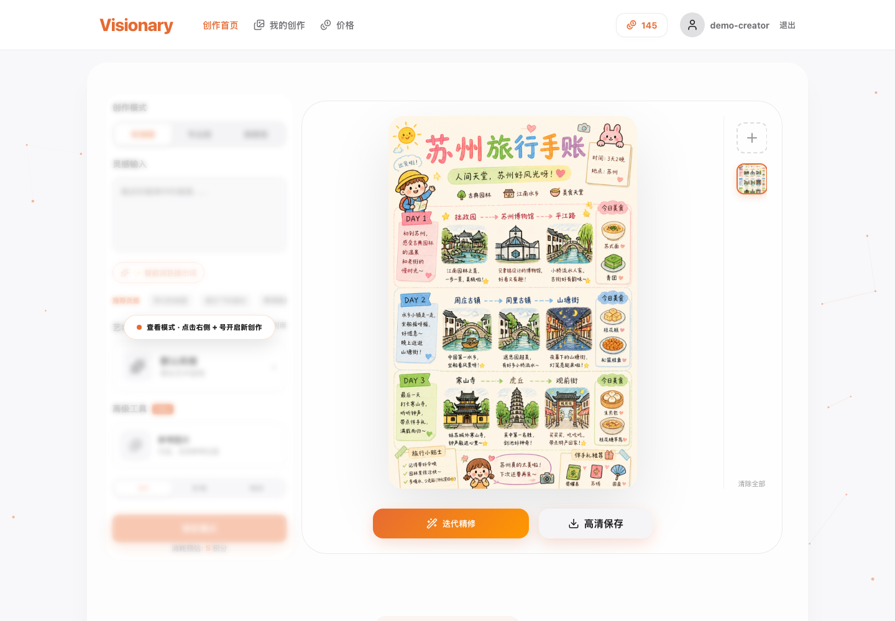

# Visionary

AI image generation with credit accounting, image history, and an admin dashboard.

用 React 与 FastAPI 搭建的 AI 生图工作台，从输入灵感、查看作品到积分结算和后台管理。

## 界面预览

<a href="docs/screenshots/home-generation.png"></a>

| 历史记录 | 积分与充值 | 管理后台 | 移动端 |
| --- | --- | --- | --- |
| [](docs/screenshots/history.png) | [](docs/screenshots/credits-recharge.png) | [](docs/screenshots/admin-dashboard.png) | [](docs/screenshots/mobile-generation.png) |

以上为本地运行截图，使用合成账号和数据；假上游返回仓库自带展示图。[截图来源与拍摄方式](docs/screenshots/SOURCES.md)。

## 功能

- **AI 助手**：先聊方案、上传参考图、版本编辑，确认后才生成；无 key 可用演示对话。
- **免费试用与配置**：新用户默认 5 次标准档试用，优先试用再积分；后台可调整试用、档位价格、注册积分和邀请奖励。
- **创作工作台**：文字生图、参考图生图、画面比例选择、风格模板与提示词润色，支持作品迭代。
- **作品管理**：历史记录、提示词复用、图片删除、下载和分享海报。
- **账号与积分**：JWT 登录、邮件验证码注册和找回密码；积分余额、消费与充值明细、人工充值报备。
- **管理后台**：充值审核、手动加分、作品与积分统计、反馈处理。
- **桌面与移动端**：分别适配的工作台布局，附 PWA 安装引导。

## 值得看的设计

### 积分先冻结，成功扣费，失败释放

提交任务时，用条件 UPDATE 检查 `points - frozen_points`，再冻结本次额度；图片生成并存储成功后扣除余额，失败则释放冻结额度。预占与最终扣费分开，失败任务不扣减用户余额。对应的消费和充值记录可在积分明细中查看。

实现：[生成与结算](backend/api/image.py)、[积分字段](backend/models/models.py)、[明细接口](backend/api/user.py)。

### 后台生成，前端轮询状态

生成接口先创建 `pending` 记录并返回任务 ID，再由 FastAPI 后台任务完成提示词包装、上游请求与图片转存。前端按 ID 轮询 `pending / generating / success / failed` 状态，将等待过程和生成结果展示在任务卡片中；后端同时记录 API、存储与总耗时。

实现：[任务处理与状态查询](backend/api/image.py)、[桌面轮询](frontend/src/pages/HomePage.jsx)、[移动轮询](frontend/src/pages/MobileHomePage.jsx)。

### 上游与存储配置独立于页面

生图上游和图片存储分别选择：没有 key 时返回内置示例图，没有完整 COS 配置时存到本地；接入自己的服务后仍走同一条后台任务与积分结算流程。配置表优先，缺项回退环境变量，并缓存 60 秒。COS 上传和本地写入集中在存储适配中，在线程池里执行；提示词润色可单独配置 Qwen 或兼容聊天接口。

实现：[配置读取](backend/core/config.py)、[提示词润色](backend/core/prompt_enhance.py)、[存储选择](backend/core/storage.py)、[演示上游](backend/core/image_provider.py)、[COS 适配](backend/core/cos.py)。更多调用关系见 [架构说明](docs/ARCHITECTURE.md)。

## 本地运行

准备 Python 3.10+、Node.js 22（22.13+）或 24+ 和 npm。数据库默认使用 SQLite。**不需要任何 key 就能完整体验一次生图**：登录、提交任务、等待结果、查看历史、下载与积分扣减。

### 一条命令启动

```bash
git clone https://github.com/bmdy6/visionary.git
cd visionary
bash scripts/dev.sh
```

脚本自动创建 `.venv`、安装前后端依赖、从 `.env.example` 生成带随机 `SECRET_KEY` 的 `.env`，初始化数据库和 `local-admin` 管理员。首次运行按提示设置至少 12 位的密码；管理员初始有 100 个本地积分。再次运行会保留已有配置、密码、数据和余额。

访问 <http://127.0.0.1:5173>，使用 `local-admin` 和刚设置的密码登录，填入提示词，点击「开启精彩创作」。成功后到「历史记录」查看和下载作品。生成结果处于查看模式时，先点右侧任务栏的「+」新建创作，再在「高级工具 → 参考图片」上传图片并提交，可体验参考图任务；也可在作品详情中复用。API 文档位于 <http://127.0.0.1:8000/docs>。

默认是**演示模式**：循环返回 `showcase/` 自带 PNG 示例图，不根据提示词、比例或参考图绘制新内容；页面会显示演示提示。任务仍执行冻结积分、后台处理、轮询和成功结算；新注册用户优先使用试用，默认标准档每次 5 分。图片和参考图写入 `backend/data/creations/`，经 `/api/creations/` 访问，不会提交到 Git。AI 助手无模型 key 时先追问一轮，再给演示方案；提示词润色、真实邮件和支付需各自配置。

按 `Ctrl+C` 同时停止前后端。脚本只监听回环地址；8000 或 5173 被占用时会退出，请先停止占用服务。不要删除 `.env` 或数据库来重置余额；需要补积分时使用本地管理后台。默认脚本用于本地开发。

### 手动启动

也可以逐步执行：

```bash
python3 -m venv .venv
source .venv/bin/activate
python -m pip install -r requirements.txt
cp .env.example .env
python -c 'import secrets; print(secrets.token_urlsafe(48))'
```

将输出的随机串填入 `.env` 的 `SECRET_KEY`，保留 SQLite 的 `DATABASE_URL`。外部服务字段留空即可演示。

```bash
# 创建空表和本地管理员，按提示设置密码
python -m scripts.init_db --admin local-admin
python -m uvicorn api.index:app --host 127.0.0.1 --port 8000
```

另开终端，从仓库根目录启动前端：

```bash
cd frontend
npm ci
npm run dev -- --host 127.0.0.1 --port 5173 --strictPort
```

### 接自己的生图服务与 COS

在 `.env` 中填写并重启后端：

```dotenv
# 有 key 时 auto 自动请求自己的上游，图片仍可保存在本地
IMAGE_PROVIDER=auto
OPENAI_BASE_URL=https://your-image-provider.example/v1
OPENAI_API_KEY=填入你自己的密钥
STORAGE_BACKEND=auto
```

请求格式见 [生成接口](backend/api/image.py)：模型字符串为 `gpt-image-2`，文生图调用 `/images/generations`，参考图调用 `/images/edits` 并传入 JSON `images` 数组。需选择支持该格式及 data URL 参考图的服务；不是所有 OpenAI 兼容服务都支持。可以返回 `data[0].url` 或 `data[0].b64_json`。本地参考图会内嵌后发给上游，不要求上游访问本机。真实生图服务可能收费。

| 配置 | 默认 | 行为 |
| --- | --- | --- |
| `IMAGE_PROVIDER` | `auto` | 有 `OPENAI_API_KEY` 用 `openai`，否则 `demo`；可显式指定 |
| `STORAGE_BACKEND` | `auto` | COS 四项配全用 `cos`，否则 `local`；可显式指定 |

显式设置 `IMAGE_PROVIDER=openai` 却无 key，或 `STORAGE_BACKEND=cos` 却缺配置，会使任务失败并释放冻结积分；不会悄悄切回演示。填写了 key 和完整 COS 配置时，默认行为与原部署一致。

需要 COS 时填写 `TENCENT_CLOUD_SECRET_ID`、`TENCENT_CLOUD_SECRET_KEY`、`TENCENT_CLOUD_COS_REGION`、`TENCENT_CLOUD_COS_BUCKET`，并确保桶内图片可公开读取。邮件验证码需要 SMTP，字段见 [.env.example](.env.example)。配置表中非空值优先于环境变量，修改已有部署配置时需留意此优先级。

本地存储适合单机开发；迁移时一起备份 SQLite 数据库和 `backend/data/creations/`。图片 URL 可直接访问，没有私有文件鉴权，勿用于敏感图像；无持久磁盘或多实例部署请使用 COS，并让反向代理将 `/api` 交给后端。

### 构建与离线测试

前端生产构建（在 `frontend/` 中执行）：

```bash
npm ci
npm run build
```

后端离线回归（在仓库根目录、激活 venv 后执行，不调用付费 API）：

```bash
python -m unittest discover -s tests -v
python tests/offline_regression.py
```

### AI 助手与免费试用

创作首页可切换「普通模式 / AI 助手」，浏览器会记住上次选择。助手先聊需求、绑定参考图并给出方案，只有点击「确认生成」才进入原有生成流程；聊天中说“生成”不会直接提交。方案可手动编辑，每次更新版本号递增，同一方案版本连点或刷新不会重复预占。结果记录来源为 `assistant`，在「我的创作」中可下载；高清和大师档沿用原有精修限制。

没有 `DASHSCOPE_API_KEY` / `OPENAI_API_KEY` 时使用固定演示对话。配置后复用提示词润色的 Qwen 优先、兼容接口回退选择；对话模型只读取文字和参考图绑定状态，图片本身在确认后传给生图服务。演示生成继续返回内置样图。聊天与方案存数据库，按用户隔离，可点「新对话」。每个对话最多 50 轮，模型上下文最多最近 20 条消息。

新注册用户默认有 5 次免费试用，与积分分开；标准档优先试用，其他档按配置判断。先预占，成功后扣除，失败释放。已有账号迁移后试用为 0，不补发。页面显示剩余试用、费用及不足金额；不足时可打开原充值弹窗。

### 系统设置 · 积分与试用

管理员在「管理后台 → 系统设置」保存，当前进程立即刷新配置缓存；其他进程最多 60 秒刷新。非空 `system_configs` → 非空 `.env` / 环境变量 → 默认值。修改记录在现有充值审计流水（`CONFIG_` 前缀、零积分、管理员和前后值），不会给账号增加余额。数字限制为 0–1000000 的整数；档位必须有效。

| 配置项 | 默认值 | 用途 |
| --- | --- | --- |
| `NEW_USER_FREE_GENERATIONS` | `5` | 新账号试用次数，0 关闭新发放；不改已有余额 |
| `TRIAL_ALLOWED_TIERS` | `standard` | 逗号分隔允许使用试用的档位 |
| `NEW_USER_POINTS` | `10` | 新账号注册积分 |
| `TIER_COSTS` | `standard:5,hd:10,master:15` | 每个档位生成消耗的积分，预占后以任务快照结算 |
| `INVITE_REWARD_POINTS` | `5` | 受邀注册奖励、邀请人首画奖励；以 Issue #3 的默认值为准 |
| `INVITE_DAILY_LIMIT` | `5` | 每位邀请人每日首画奖励次数上限 |
| `ASSISTANT_MODE_ENABLED` | `true` | 隐藏助手切换并拒绝新聊天、编辑和方案提交 |

升级已有数据库前，先停服务并备份数据库，然后运行 `python -m scripts.init_db`（复用当前 `DATABASE_URL`）。这是可重复执行的增量迁移，保留已有账号、密码和积分；`scripts/dev.sh` 也会执行它。首次建库不需要另做迁移。回退到旧版应用可保留新增表和列，勿直接删除数据库。

后端离线检查：`python -m unittest discover -s tests -v`、`python tests/offline_regression.py`。可选 headless 编辑回归在 `tests/assistant_editor.mjs`：另行安装 Playwright，设置 `VISIONARY_TEST_USERNAME`、`VISIONARY_TEST_PASSWORD` 为合成测试账号（需已有助手方案），运行 `node tests/assistant_editor.mjs`；`PLAYWRIGHT_MODULE` 可指向独立安装的模块。请使用演示或回环假服务，不调用真实付费接口。

## 技术栈

| 部分 | 技术 |
| --- | --- |
| 前端 | React 19、Vite 8、React Router 7、Axios、Lucide、CSS |
| 图片与分享 | html2canvas、qrcode.react |
| 后端 | FastAPI、SQLAlchemy、Pydantic、HTTPX |
| 认证与存储 | python-jose、bcrypt、腾讯云 COS SDK |
| 本地数据库 | SQLite |

依赖见 [前端清单](frontend/package.json) 和 [Python 清单](requirements.txt)。代码采用 [MIT License](LICENSE)。

## 已知限制

- 后台任务在 Web 进程内运行；持久化队列、重启恢复及积分结算与重置的并发约束仍待完善。
- 对外开放前需加固接口归属、图片代理和账号验证；支付适配的回调金额校验也需完善。
- 上游有特定请求格式要求；界面档位影响计费和提示词，但发送给上游的 `quality` 均为 `low`。
- 无 key 演示仅返回已有图；本地文件需备份，删除历史记录不清理文件。真实生图、COS、邮件、支付、MySQL 和 PWA 真机仍需各自验收；依赖仍有开发工具告警。
- 历史展示素材的权利来源需单独确认，代码的 MIT 许可不覆盖第三方图像权利。

详见 [完整限制与验证范围](docs/LIMITATIONS.md)。
